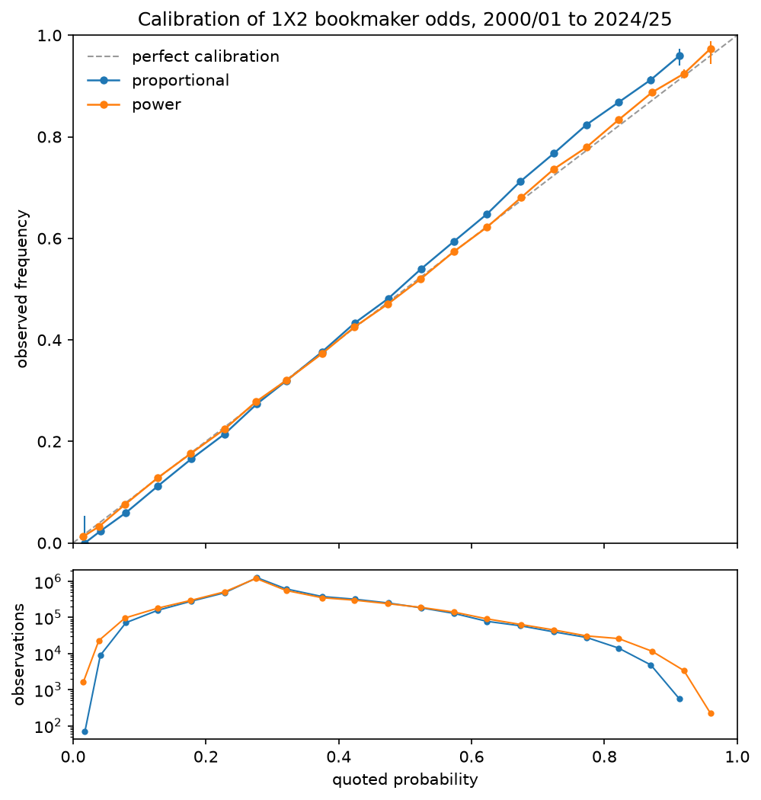

# odds-calibration

Are bookmakers well calibrated?

Odds imply a probability. If a bookmaker quotes 20% on a thousand matches, about two
hundred should happen. This repo checks that against twenty-five seasons of football
results, and measures where the margin sits.

Across 1.47 million bookmaker quotes the median book keeps **6.94%** of turnover,
and that figure has roughly halved since 2000. The calibration curve is now drawn on
4.40 million outcome observations: proportionally normalised, the quotes show the
textbook favourite-longshot shape, outcomes priced near 0.08 occurring 0.060 of the
time and outcomes priced near 0.72 occurring 0.767 of the time. The power
normalisation removes most of that tilt, which is what it is built to do.

## Setup

```bash
python3 -m venv .venv
source .venv/bin/activate
pip install -r requirements.txt
pip install -e .
```

## Get the data

```bash
python -m oddscal.download                      # 18 leagues, seasons 2000/01 to 2024/25
python -m oddscal.download --leagues E0 --from 2020 --to 2024   # a smaller slice
```

Files land in `data/raw/<season>/<league>.csv`, which is git-ignored. Reruns are
cached, so only missing files are fetched. A league that did not run in a given season
returns 404, which counts as missing rather than as a failure.

## Use it

```python
from oddscal.load import load_matches
from oddscal.probabilities import build_raw_probabilities
from oddscal.overround import add_overround, summarise_overround
from oddscal.normalise import normalise, compare_methods

matches = load_matches()                    # one row per match
quotes = build_raw_probabilities(matches)   # one row per (match, bookmaker)
quotes = add_overround(quotes)              # booksum, overround, margin
clean = normalise(quotes, "proportional")   # p_home, p_draw, p_away summing to 1

summarise_overround(quotes, by=["bookmaker"])
compare_methods(quotes)                     # both normalisations side by side

from oddscal.calibration import to_observations, bucket_calibration, plot_calibration

obs = to_observations(quotes, method="proportional")  # 3 rows per quote
table = bucket_calibration(obs)                       # one row per bucket
plot_calibration({"proportional": table}, path="figures/calibration.png")
```

`quotes` carries `odds_home/draw/away` and the reciprocals `p_raw_home/draw/away`.
Raw means unnormalised: the three add up to more than 1, and that excess is the
margin. Normalising is the next step, and doing it earlier would hide the quantity
the project is trying to measure.

## What the source actually contains

Measured on the full default league set, seasons 2000/01 to 2024/25:

| | |
|---|---|
| Files downloaded | 450 of 450, no failures |
| Size on disk | 45.1 MiB |
| Matches with a result | 166,628 |
| Seasons, divisions | 25, 18 |
| Date range | 2000-07-28 to 2025-06-01 |
| Dates that failed to parse | 0 |
| Distinct 1X2 odds triples | 31 |
| Quotes, match by source | 1,491,529 |
| Home / draw / away | 74,856 / 44,798 / 46,974 |

That clears the 50,000 match target in the roadmap with room to spare. Loading the
whole archive takes about 30 seconds.

Four quirks in the archive, all handled in `load.py` and `sources.py`:

- 11 of the 450 files are latin-1 rather than utf-8, and several carry a utf-8 BOM
- the Greek files from 2000 to 2005 name the teams `HT` and `AT`
- most files end in a block of blank filler rows, and some rows are short
- `Max`, `Avg` and the older `BbMx`, `BbAv` are the site's maximum and mean across
  bookmakers, not quotes anyone offered. They are tagged as aggregates and excluded
  by default

One sanity check on the conversion: 99.9987% of the 1.49 million quotes imply
probabilities summing above 1, as they must. The 20 that do not are handled below.

## The margin

The three raw probabilities sum to the *booksum* B. Two numbers come out of it and
they are not the same:

| | | on this archive |
|---|---|---|
| overround | B - 1 | 7.98% mean |
| margin | (B - 1) / B | 6.94% median, 7.29% mean |

The margin is the one worth quoting. Normalise proportionally, take the result as
true, and a unit staked on any of the three outcomes returns `1/B - 1 = -(B-1)/B`.
Every outcome carries the same expected loss, and it equals the margin.

Measured on 1,465,200 bookmaker quotes, excluding the exchange and the aggregates.
The middle 80% of books sit between 3.02% and 11.11%.

### Who charges what

Median margin per bookmaker, over whatever the archive holds for each:

| Bookmaker | Quotes | Median margin |
|---|---|---|
| Pinnacle | 172,005 | 2.73% |
| 1XBet | 13,015 | 4.82% |
| VC Bet | 159,006 | 5.41% |
| Bet365 | 191,782 | 6.02% |
| Bet&Win | 174,174 | 7.03% |
| William Hill | 194,356 | 7.36% |
| Stan James | 60,563 | 7.87% |
| Blue Square | 39,758 | 8.62% |
| Gamebookers | 83,519 | 9.24% |
| Sportingbet | 75,040 | 9.39% |
| Interwetten | 183,587 | 9.41% |
| Sporting Odds | 6,575 | 10.33% |
| Ladbrokes | 106,776 | 10.56% |
| Stanleybet | 5,044 | 10.83% |

Pinnacle at a quarter of Stanleybet's margin is the known result and it survives
here. But this table is not a fair ranking: these are different samples, different
leagues and different decades. The honest comparison comes at step 8, on the matches
the books priced in common.

### The margin has halved, and it is not a composition effect

Grouping every quote by season shows the median falling from 11.4% in 2000/01 to
5.3% in 2024/25. That could just be Pinnacle arriving late and dragging the average
down, so the same curve held to a single bookmaker throughout:

| Bookmaker | First season | Last season |
|---|---|---|
| William Hill | 11.21% (2000/01) | 6.09% (2024/25) |
| Interwetten | 14.92% (2000/01) | 5.76% (2023/24) |
| Bet365 | 10.92% (2002/03) | 5.97% (2024/25) |

The decline is real, roughly a halving inside each book, but the three do not get
there the same way. William Hill sits flat near 11% until 2008/09 then drops to 6.5%
within two seasons; Bet365 makes the same jump in one, 8.5% to 6.3% between 2007/08
and 2008/09. Interwetten has no step at all and grinds down across the whole period.
A shared cause would be worth a look, though nothing here establishes one.

### Two comparisons that mostly measure the sample

- **Opening against closing.** Grouped naively, closing quotes look 2.9 points
  tighter (4.95% against 7.82%). Restricted to the 267,565 (match, bookmaker) pairs
  carrying both, the median difference is 0.03 points, and closing is tighter in
  53.6% of pairs. The naive gap was measuring which seasons publish a closing price.
- **Exchange against bookmakers.** On the 6,589 matches priced by both, Betfair's
  median booksum implies 4.59% against 5.29% for the bookmakers. The gap is real but
  the numbers are not comparable: the exchange takes commission on winnings rather
  than pricing its cut into the quote.

By division the spread is narrower than by bookmaker: the Premier League is tightest
at 5.69% and the Spanish second division widest at 8.30%, with the other sixteen in
between. Top flights are cheaper than the divisions below them, everywhere.

### The 20 bad books

`drop_implausible_books` removes the quotes whose booksum is at or below 1. There are
20 in 1.49 million, the worst being 8.00 / 3.75 / 4.33 on Rimini against Juventus in
2006, which sums to 0.62. They are typing errors in the archive rather than
arbitrage. Dropping them is the right thing to do and it changes the headline margin
by less than 0.0001 points, which is the answer this filter deserved.

## Normalising: an assumption, not a cleanup

Removing the margin is a choice about *where* the bookmaker put it, and the two
standard choices disagree about the same quote.

**Proportional** divides each raw probability by the booksum. Every outcome is shaded
by the same factor, which is what makes the expected loss identical across the three
and the margin the number worth quoting.

**Power** raises each raw probability to a common exponent k solving `sum p^k = 1`.
Since every raw probability is below 1 and they sum above it, k > 1, and a power above
1 shrinks small numbers proportionally harder. So the power method takes more margin
out of the longshot, encoding the belief that the favourite-longshot bias is real.

Both are exact to floating point on the archive, maximum `|sum - 1|` of 4.4e-16.
The exponent is solved per quote by bisection: median k is **1.0781**, the middle 80%
spans 1.0315 to 1.1330, and k exceeds 1 on 100% of the 1,465,200 bookmaker quotes.

### How far apart they are

Mean gap, power minus proportional, by proportional probability:

| Proportional p | Quotes | Mean proportional | Mean power | Relative gap |
|---|---|---|---|---|
| 0.00 to 0.10 | 80,945 | 0.0752 | 0.0595 | **-20.9%** |
| 0.10 to 0.20 | 442,334 | 0.1598 | 0.1460 | -8.6% |
| 0.20 to 0.35 | 2,375,367 | 0.2784 | 0.2735 | -1.8% |
| 0.35 to 0.50 | 956,139 | 0.4178 | 0.4247 | +1.7% |
| 0.50 to 0.70 | 453,046 | 0.5750 | 0.5956 | +3.6% |
| 0.70 to 1.00 | 87,769 | 0.7647 | 0.7998 | +4.6% |

The gap is monotone and it crosses zero around a third. On the longest shots the two
methods differ by a fifth of the probability, which is far too large to treat the
choice as a formality: the favourite-longshot test at step 7 will move with it, and
any calibration figure has to name the method that produced it.

Which one is better calibrated is not settled by the shape of the gap alone. The
curve below says where each one sits; the Brier score, step 6, is what scores them.

Proportional runs in 0.45s on the full archive, power in 9.3s.

## The calibration curve

Every quote is three probabilities and exactly one of them happened, so a quote
becomes three observations. Grouping them by probability and counting how often the
outcome occurred gives 4,395,600 observations from 1,465,200 bookmaker quotes, of
which 1,465,200 occurred, one per quote by construction.



Proportionally normalised, in equal-width buckets:

| Quoted p | Observations | Mean quoted | Observed | 95% Wilson | Gap |
|---|---|---|---|---|---|
| 0.02 to 0.05 | 8,969 | 0.0411 | 0.0233 | 0.0204 to 0.0266 | **-0.0178** |
| 0.05 to 0.10 | 71,907 | 0.0796 | 0.0595 | 0.0578 to 0.0613 | **-0.0200** |
| 0.10 to 0.15 | 158,890 | 0.1277 | 0.1121 | 0.1105 to 0.1136 | -0.0156 |
| 0.15 to 0.20 | 283,444 | 0.1778 | 0.1653 | 0.1639 to 0.1666 | -0.0126 |
| 0.20 to 0.25 | 483,229 | 0.2278 | 0.2143 | 0.2131 to 0.2154 | -0.0135 |
| 0.25 to 0.30 | 1,270,664 | 0.2770 | 0.2740 | 0.2733 to 0.2748 | -0.0029 |
| 0.30 to 0.35 | 621,474 | 0.3207 | 0.3189 | 0.3178 to 0.3201 | -0.0018 |
| 0.35 to 0.40 | 381,818 | 0.3749 | 0.3762 | 0.3747 to 0.3778 | +0.0014 |
| 0.40 to 0.45 | 321,670 | 0.4241 | 0.4332 | 0.4315 to 0.4349 | +0.0091 |
| 0.45 to 0.50 | 252,651 | 0.4745 | 0.4813 | 0.4794 to 0.4833 | +0.0068 |
| 0.50 to 0.55 | 185,314 | 0.5243 | 0.5401 | 0.5378 to 0.5423 | +0.0158 |
| 0.55 to 0.60 | 130,242 | 0.5736 | 0.5940 | 0.5913 to 0.5966 | +0.0204 |
| 0.60 to 0.65 | 78,245 | 0.6234 | 0.6481 | 0.6447 to 0.6514 | +0.0247 |
| 0.65 to 0.70 | 59,245 | 0.6731 | 0.7116 | 0.7079 to 0.7152 | +0.0385 |
| 0.70 to 0.75 | 40,076 | 0.7238 | 0.7672 | 0.7631 to 0.7713 | +0.0434 |
| 0.75 to 0.80 | 27,992 | 0.7733 | 0.8240 | 0.8195 to 0.8284 | **+0.0508** |
| 0.80 to 0.85 | 14,281 | 0.8211 | 0.8677 | 0.8620 to 0.8731 | +0.0466 |
| 0.85 to 0.90 | 4,855 | 0.8698 | 0.9123 | 0.9040 to 0.9199 | +0.0424 |
| 0.90 to 0.95 | 565 | 0.9126 | 0.9593 | 0.9397 to 0.9727 | +0.0467 |

The first bucket, below 0.02, holds 69 observations and none of them occurred. It is
in the figure and it means nothing on its own.

The gap is negative on every bucket below 0.35 and positive on every bucket above it,
crossing over around a third. Read as a statement about prices rather than about
probabilities: outcomes the book prices long happen less often than the price says,
and outcomes it prices short happen more often. That is the favourite-longshot bias,
and it is what step 7 has to test properly rather than read off a curve.

Two numbers over the whole table: the size-weighted mean absolute gap is **0.0087**,
and 18 of the 20 buckets have a Wilson interval excluding their own mean quoted
probability. The second number deserves less weight than it looks like it carries.
At this sample size almost any systematic gap becomes significant, and the three
observations from one quote are not independent, so the intervals are narrower than
they should be.

Under the power normalisation the same table is much flatter: weighted mean absolute
gap **0.0026** against 0.0087, and the extreme buckets that were off by 4 to 5 points
come back to 1 or 2. The tilt has not been measured away, it has been assumed away.
Power puts extra margin on the longshot by construction, so a flatter curve is the
method doing exactly what it was defined to do, not evidence that it is right. Which
of the two describes the world is a scoring question, and the answer waits for step 6.

Equal-count buckets tell the same story with the thin ends filled in: 20 buckets of
about 219,800 observations each, weighted mean absolute gap 0.0090 proportional
against 0.0031 power. `bucket_calibration(obs, bins=20)` produces them.

## Run the tests

```bash
pytest
```

Roadmap and progress: [TODO.md](TODO.md)
